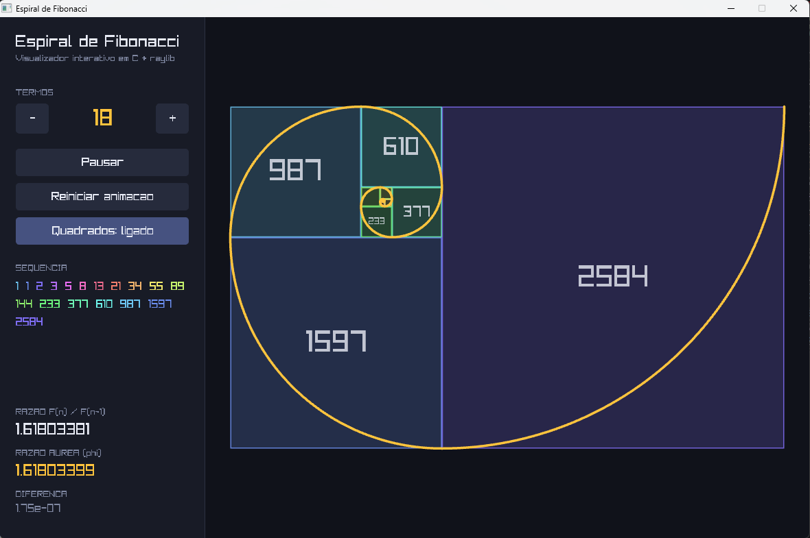

# 🌀 Espiral de Fibonacci

Visualizador interativo da **espiral áurea**, feito em **C** com a biblioteca [raylib](https://www.raylib.com/).

O programa desenha a espiral passo a passo, quadrado por quadrado, e mostra como a razão entre termos consecutivos da sequência de Fibonacci se aproxima da **razão áurea (φ ≈ 1,618)**.



## Funcionalidades

- Animação da espiral sendo construída, com câmera que ajusta o zoom automaticamente
- De 2 a 18 termos, ajustáveis em tempo real
- Painel lateral com a sequência e a comparação **F(n) / F(n-1)** × **φ**
- Botões para pausar, reiniciar a animação e ocultar os quadrados
- Interface escura, com cores diferentes para cada termo

## Controles

| Ação | Teclado | Mouse |
|---|---|---|
| Mais / menos termos | `→` / `←` | botões `+` / `-` |
| Pausar / continuar | `Espaço` | botão **Pausar** |
| Reiniciar animação | `R` | botão **Reiniciar animacao** |

## Como compilar (Windows)

**Requisitos:** um compilador `gcc` (MinGW-w64) e a raylib.

1. Baixe a raylib em [github.com/raysan5/raylib/releases](https://github.com/raysan5/raylib/releases) (versão `win64_mingw-w64`) e extraia em `C:\raylib`.
2. Na pasta do projeto, compile:

```
gcc fibonacci_spiral.c -o fibonacci_spiral.exe -I C:\raylib\include -L C:\raylib\lib -lraylib -lopengl32 -lgdi32 -lwinmm
```

3. Execute:

```
.\fibonacci_spiral.exe
```

> Se mudar o código, compile de novo antes de executar.

## Como funciona

- **Sequência:** `F(1) = 1`, `F(2) = 1` e `F(n) = F(n-1) + F(n-2)`.
- **Quadrados:** cada termo vira um quadrado de lado `F(n)`, encostado no lado seguinte do retângulo formado até ali (direita, topo, esquerda, base, e assim por diante).
- **Espiral:** em cada quadrado desenha-se um arco de 90° com raio `F(n)`. Cada arco começa onde o anterior terminou, então a curva fica contínua.
- **Razão áurea:** `F(n) / F(n-1)` tende a `φ = (1 + √5) / 2`. Com 18 termos, a diferença já fica na casa de `10⁻⁷`.

## Estrutura

```
.
├── fibonacci_spiral.c   # código-fonte completo
├── docs/
│   └── screenshot.png   # captura de tela usada neste README
└── README.md
```

## Tecnologias

- Linguagem **C**
- [raylib](https://www.raylib.com/) para janela, desenho e entrada
